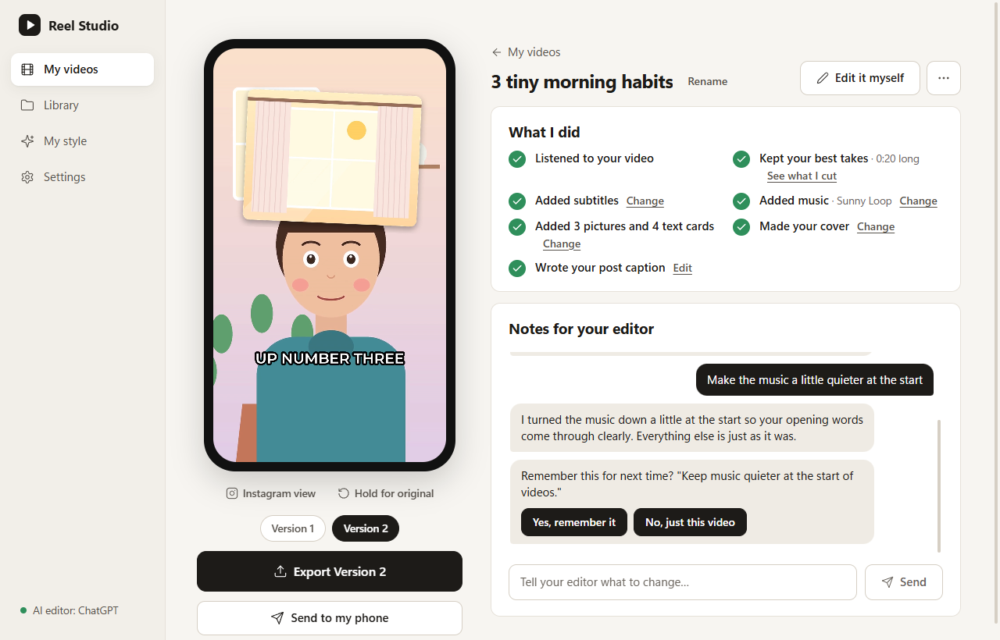
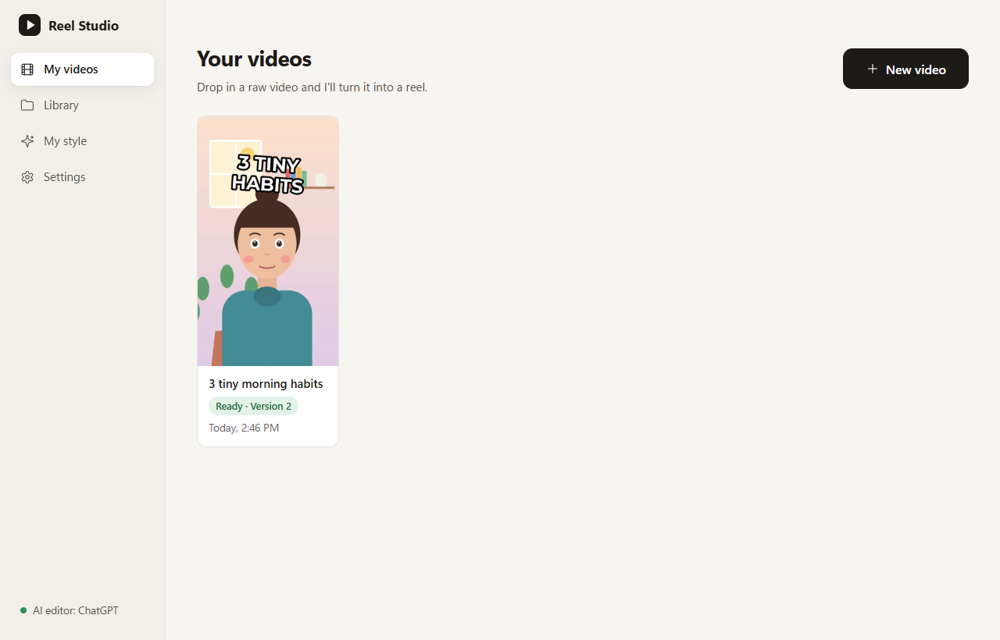
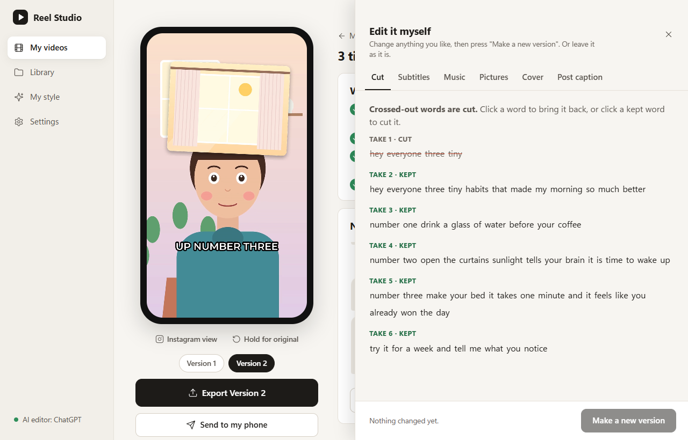
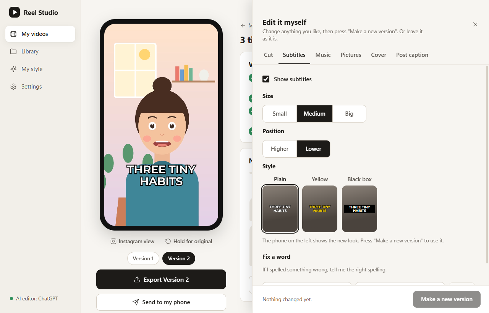
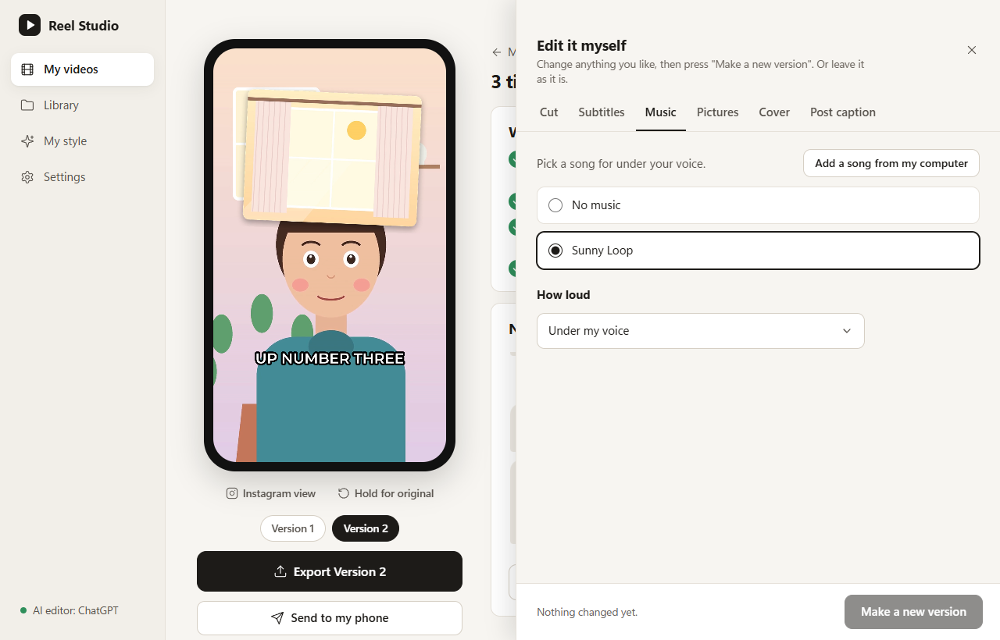
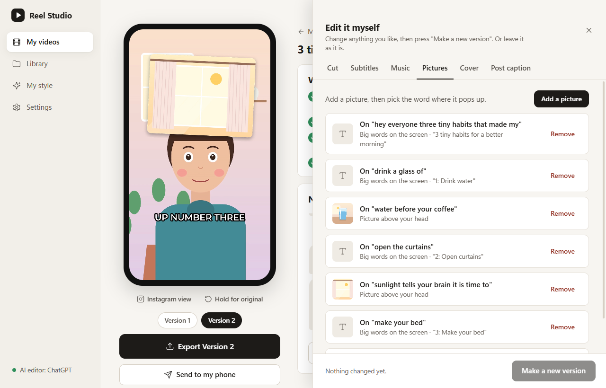
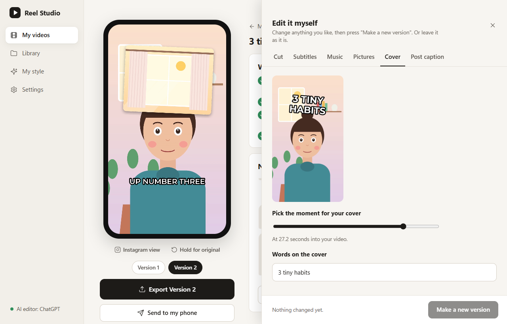
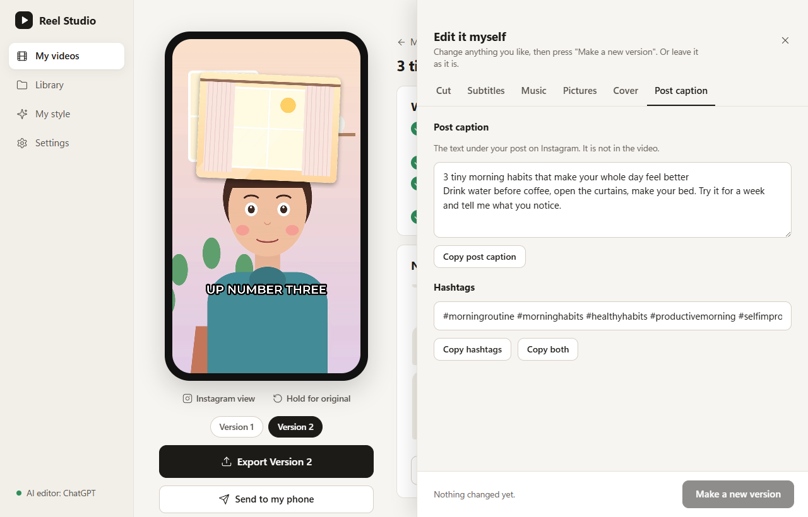
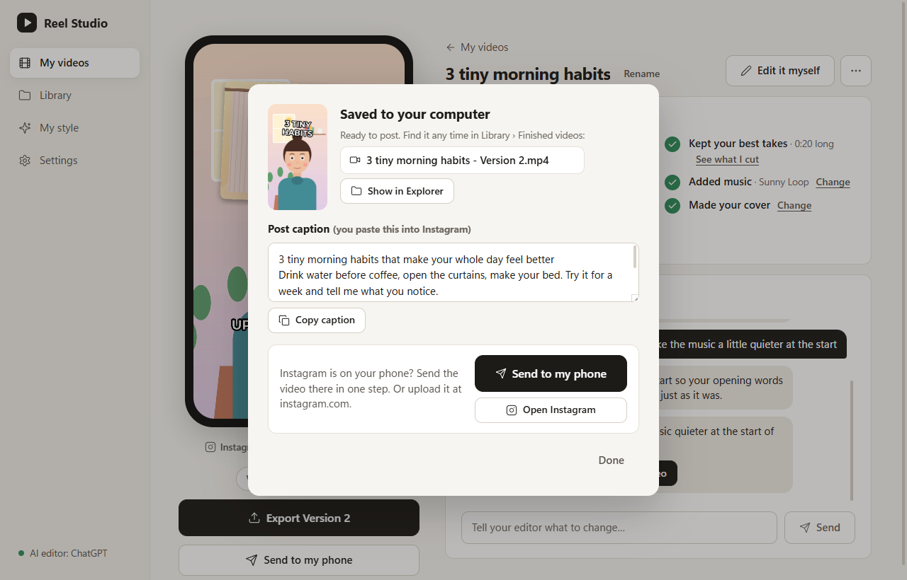
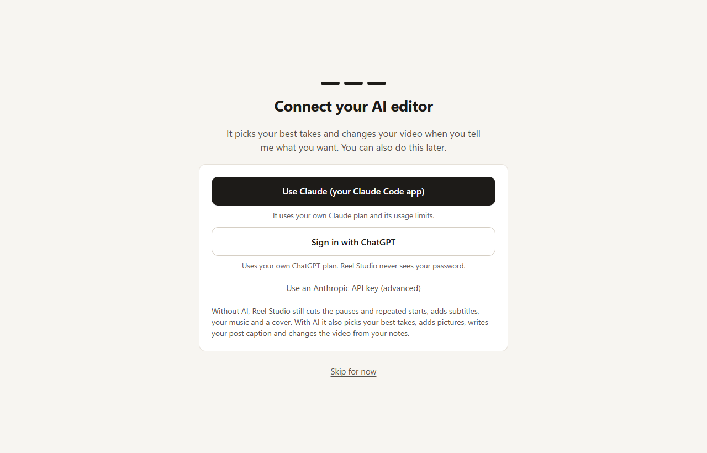

# Reel Studio

Turn a raw talking-head video into a finished, postable 9:16 Reel. Drop in your takes, retakes and
fumbles included. Reel Studio listens, picks your best take of every line, cuts the pauses, adds captions,
puts your own music under your voice, adds b-roll and a cover, and writes the post caption. Then you type
notes in plain English ("music too loud at the start") and get a new version. Paste, drop or attach a picture,
GIF or short clip to a note ("put this over my face when I say 'the ick'") and it goes on those words.

It is an open source desktop app for **macOS (Apple silicon)** and **Windows 10/11 (64-bit)**.
No account, no telemetry: your videos stay on your computer.

<p align="center">
  
</p>

*The Reel screen. A raw take became a finished reel with subtitles, music, pictures, text cards and a cover. Type a
note ("music too loud at the start") and a new version appears next to the old one.*

<p align="center">
  
</p>

*Your videos. Drop in a raw video and it shows up here with its cover when it is ready.*

### Change anything yourself

"Edit it myself" opens a drawer with one tab for each part of the reel. Change what you like, then make a new
version, or leave it as it is.

| | |
|---|---|
| <br>*Cut: your words, the cut ones crossed out. Click to bring one back.* | <br>*Subtitles: size, position and style, previewed on the phone.* |
| <br>*Music: pick a song from your Library and how loud it sits.* | <br>*Pictures: every picture and text card, and the words it appears on.* |
| <br>*Cover: pick the moment and the words on it.* | <br>*Post caption: the text under your post, with hashtags, ready to copy.* |

### Export

<p align="center">
  
</p>

*Export saves the video to your computer, with the post caption ready to copy, and can send it to your phone.*

The demo reel in these pictures is a cartoon presenter with a synthetic voice and a synthesised song, all made for
this project. Credits: [docs/images/CREDITS.md](docs/images/CREDITS.md).

## Download and install

[Buy Reel Studio at getreelstudio.com](https://getreelstudio.com/): $99 once (perpetual license plus all 1.x
updates) or $20 a month, cancel anytime. The download link for the installers is on the page right after
payment, and the app tells you when a newer version is out. Buying funds development and gets you the signed
builds, updates and help. You still need your own Claude or ChatGPT plan for the AI editor.

The code is MIT, so anyone can [build it themselves](#build-from-source) for free.

| System | File | Guide |
|---|---|---|
| Windows 10/11, 64-bit | `Reel-Studio-Setup-<version>-x64.exe` | [Install on Windows](docs/install-windows.md) |
| macOS 14+, Apple silicon | `Reel-Studio-<version>-arm64.dmg` | [Install on a Mac](docs/install-mac.md) |

The Mac app is signed and notarized by Apple, so it opens with a double-click. The Windows installer is not
signed with a paid certificate yet, so Windows SmartScreen warns the first time you open it; the Windows guide
shows the two extra clicks. The first time you open the app it downloads its speech model (about 500 MB, once).

## How the AI works

The AI is optional. Without it, Reel Studio still transcribes your video, cuts the pauses and repeated
starts, adds captions, mixes in the song you choose, and makes a cover.

With an AI connected, it also picks your best takes, finds pictures and builds simple animation cards, writes
your post caption, and handles your notes. You choose one of:

* **Connect Claude.** Needs a paid Claude plan (Pro or Max). One click installs Anthropic's Claude Code app if
  you don't have it, then opens Anthropic's own sign-in page in your browser. Reel Studio never sees that
  sign-in, your password or any token: Anthropic's app keeps it. The edits run on your own Claude plan and
  count toward its usage limits.
* **Connect ChatGPT.** Works with your ChatGPT plan, free ones too (with their limits). One click installs
  OpenAI's Codex app if you don't have it, then opens OpenAI's own sign-in page. Same rules: Reel Studio never
  sees the sign-in, and the edits run on your own ChatGPT plan.
* **A Claude API key** (advanced). Paste a key from the Anthropic Console. It is stored encrypted with your
  operating system's secure storage.

If one of those apps is already signed in on your computer, it is the first choice offered; nothing switches
to it until you click it. The installers are the vendors' own (the scripts on their install pages), downloaded
and run for you.

<p align="center">
  
</p>

The AI does not write code or ffmpeg commands. It reads the transcript and the project, then changes a
project file through a fixed list of actions; a deterministic engine renders that file. The same project in
always gives the same video out. Details: [docs/architecture.md](docs/architecture.md).

## Privacy

Everything runs on your computer: transcription, cutting, captions, rendering. Your videos and songs are
never uploaded.

If you connect an AI, the provider you chose (OpenAI or Anthropic) receives only what the editor needs to do
its job:

* the **transcript text** with word timings, and the retake and pause analysis of it;
* the **project file** (cut, caption, music and b-roll settings, titles, and the file names in your Library);
* a **few still frames** (at most six at a time) from a preview of your edit, so it can check its own work;
* your **notes** and your saved **style rules**;
* for each picture, GIF or clip you **attach to a note**: one small still of it, plus its file name, size and
  length. The file itself stays on your computer.

With "Use Claude (your Claude Code app)", the same things go to Anthropic through the Claude Code app you signed
in to, on your own Claude plan. Reel Studio starts that app on your computer and asks it whether you are signed
in; it never reads, stores or passes on your Claude sign-in.

Nothing else is sent. With no AI connected, nothing is sent at all.

Reel Studio itself makes only these other network requests, and only when you use the feature: the one-time
speech model download from Hugging Face, image search (Openverse and Wikimedia Commons) and brand logos
(Simple Icons) with the words the AI chose, a screenshot of a website or app page the AI names in your reel, and downloads of pictures, videos or songs from links you paste. There is no analytics and no
crash reporting.

One request happens without you asking: at most once a day it asks `dl.getreelstudio.com/latest.json` whether a
newer version is out, sending only a generic
`User-Agent: ReelStudio/<version>` and no cookies, account or ID. If there is one, a small note says so; nothing
is downloaded or installed. Turn it off in Settings with "Check for updates".

## Build from source

You need Node.js 22 or newer and Python 3.11. For development on a machine without the bundled runtime, put
`ffmpeg` and `ffprobe` (7.1 recommended) on your PATH.

```
git clone https://github.com/AidenJohnston/reel-studio-app.git
cd reel-studio-app
npm install
npm run build -w ai          # the app loads the built AI package
```

Set up the engine (the app uses `engine/.venv` automatically when it exists):

```
cd engine
python -m venv .venv
# Windows:  .venv\Scripts\pip install -e ".[dev]"      macOS:  .venv/bin/pip install -e ".[dev]"
cd ..
```

Run the app and the tests:

```
npm run dev                  # the app, with hot reload
npm test                     # app + ai unit tests
npm run typecheck
cd engine && python -m pytest tests          # engine tests (the compositing suite takes a few minutes)
npm run e2e                  # Electron end-to-end tests (slower; needs the engine venv)
```

Build the installers (they bundle Python, ffmpeg and fonts, about 250 MB of downloads the first time):

```
# Windows (PowerShell)
powershell -ExecutionPolicy Bypass -File packaging\build-win.ps1

# macOS (Apple silicon)
packaging/build-mac.sh
```

Packaging details, signing and notarizing: [packaging/README.md](packaging/README.md) and
[docs/signing-mac.md](docs/signing-mac.md).

## Project layout

| Path | What |
|---|---|
| `app/` | Electron + React + Vite desktop app |
| `ai/` | Providers, prompts, editor tools and the agent loop (TypeScript) |
| `engine/` | The media engine: transcribe, cut, captions, b-roll, music, render (Python) |
| `templates/` | HTML animation templates and fonts |
| `packaging/` | Installer config, runtime fetch scripts, licenses |
| `docs/` | Install guides, architecture, design notes |

## License and third-party notices

Reel Studio is released under the [MIT License](LICENSE).

The installers also contain other programs, each under its own license: FFmpeg and FFprobe (GPL v3, run
as separate programs), Python and its libraries, Electron, fonts (SIL OFL and Apache 2.0), and the YuNet face
detector (MIT). Full list, license texts and where to get the corresponding FFmpeg source:
[THIRD_PARTY.md](THIRD_PARTY.md) and [engine/THIRD_PARTY.md](engine/THIRD_PARTY.md). Every release
publishes that source next to the installers.

## Credits

The editing method follows the Minimum Viable Editing Strategy as described by **Mino Lee**, credited here with
Mino's permission.

## Contributing

See [CONTRIBUTING.md](CONTRIBUTING.md).
